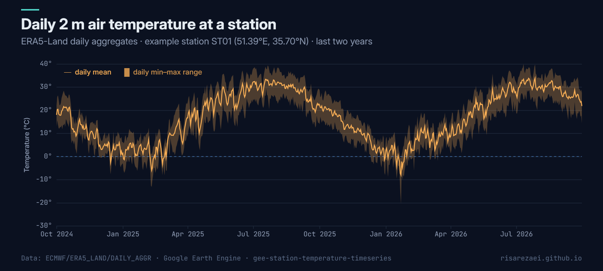

# Station Temperature Time Series (ERA5-Land)

[](https://code.earthengine.google.com)
[](https://developers.google.com/earth-engine/datasets/catalog/ECMWF_ERA5_LAND_DAILY_AGGR)
[](LICENSE)
[](https://doi.org/10.5281/zenodo.23646400)

Extract **daily 2 m air temperature** (mean, minimum and maximum) for any number of station locations from ERA5-Land, and export it as one clean CSV in °C: one row per station per day. It's useful for filling gaps in station records, driving hydrological models, or comparing stations against reanalysis.



<sub>Example output: two years of daily ERA5-Land temperature (mean line, min–max band) at one station.</sub>

## What the script does

1. Loads your stations (an asset, or an inline list).
2. Reads the ERA5-Land daily aggregates and converts Kelvin to °C.
3. Samples every day at every station.
4. Charts the last two years at the first station as a quick check.
5. Exports a tidy CSV to Google Drive.

## Quick start

1. Open the [Earth Engine Code Editor](https://code.earthengine.google.com).
2. Paste [`station_temperature_timeseries.js`](station_temperature_timeseries.js) into a new script.
3. Set `STATIONS_ASSET` and `ID_FIELD`, or edit the inline `stations` list.
4. Set `startDate` / `endDate`, press **Run**, then start the export from **Tasks**.

## Configuration

| Parameter | Default | Description |
|---|---|---|
| `STATIONS_ASSET` | `null` | Point `FeatureCollection` asset with your stations |
| `stations` | 2 examples | Inline `{id, lon, lat}` list, used when no asset is given |
| `ID_FIELD` | `'stationid'` | Station ID property in the asset |
| `startDate` / `endDate` | 1986-09-23 / 2018-09-23 | Period (end date exclusive); ERA5-Land starts in 1950 |
| `variables` | mean, min, max | Output column → ERA5-Land band |

## Output

`station_temperature_daily.csv` (long / tidy format)

| station_id | date | t2m_mean_C | t2m_min_C | t2m_max_C |
|---|---|---|---|---|
| ST01 | 1986-09-23 | … | … | … |

To get one column per station (wide format), use pandas:

```python
import pandas as pd
df = pd.read_csv("station_temperature_daily.csv", parse_dates=["date"])
wide = df.pivot(index="date", columns="station_id", values="t2m_mean_C")
```

## Notes

- ERA5-Land has a ~9 km (0.1°) grid, so each station takes the value of the grid cell it falls in.
- Stations over open water or outside land cells return empty values.
- Long periods × many stations can make large exports; split the period if a task runs too long.

## Data

Muñoz Sabater, J. (2019). ERA5-Land hourly data from 1950 to present. Copernicus Climate Change Service (C3S) Climate Data Store. Earth Engine: [`ECMWF/ERA5_LAND/DAILY_AGGR`](https://developers.google.com/earth-engine/datasets/catalog/ECMWF_ERA5_LAND_DAILY_AGGR).

## Cite this tool

Abbasalizadehrezaei, P. (2026). *Daily Temperature at Multiple Stations* (Version 1.0.0) [Software]. Zenodo. https://doi.org/10.5281/zenodo.23646400

GitHub also offers a ready-made citation under **Cite this repository** (from [CITATION.cff](CITATION.cff)).

## Author

**Parisa Abbasalizadehrezaei** · [risarezaei.github.io](https://risarezaei.github.io)

Released under the [MIT License](LICENSE).
